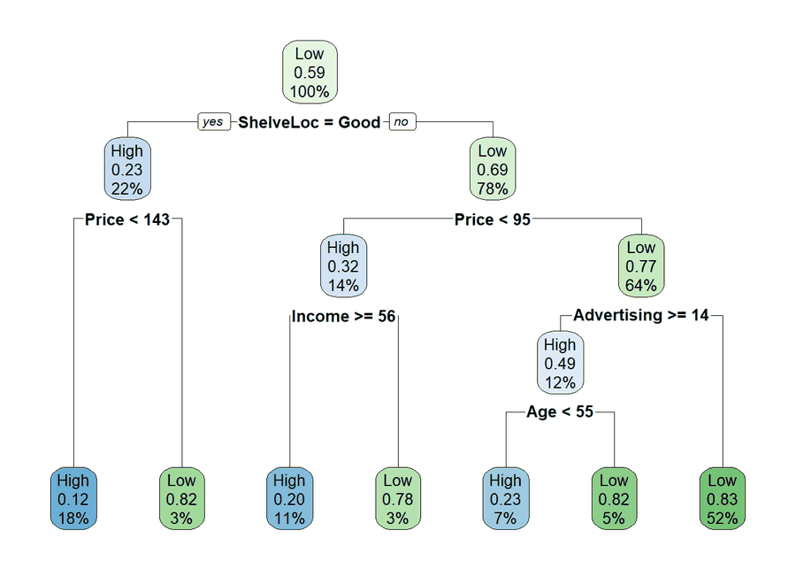
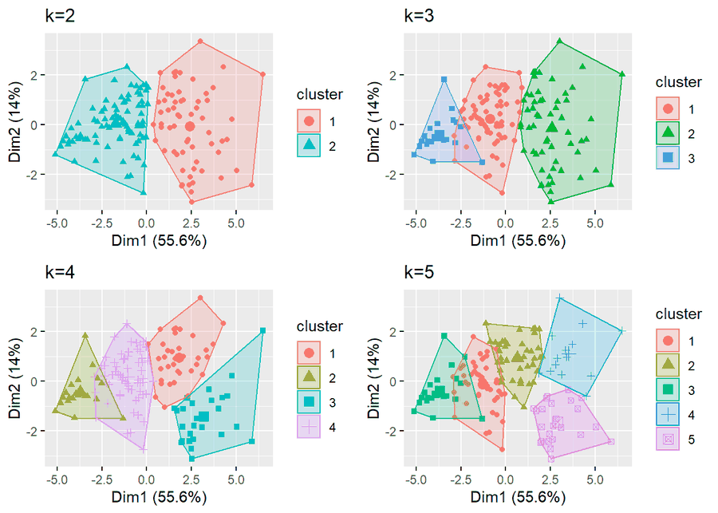

# R ile Veri Görselleştirme ve Makine Öğrenmesi Yöntemleri

R ile veri keşfi, görselleştirme ve temel makine öğrenmesi yöntemlerini iki veri seti üzerinde
adım adım anlatan Türkçe bir çalışma. Her yöntem önce kısaca açıklanır, sonra R koduyla uygulanır
ve çıktısı yorumlanır.

**Rapor:** [`ML.html`](ML.html) dosyasını indirip tarayıcıda aç (yaklaşık 29 MB; GitHub önizleme göstermez).




## İçerik

| Bölüm | Konular |
|---|---|
| Veri hazırlığı | Eksik gözlem analizi, veri setinin eğitim ve test olarak parçalanması |
| Görselleştirme | Histogram, kutu grafiği, saçılım, korelasyon, pasta, balon grafiği, 3B grafik, dünya haritası |
| Normal dağılım | Normallik varsayımı, çarpıklık ve basıklık ölçüleri |
| Regresyon | Çoklu doğrusal regresyon |
| Sınıflandırma | Lojistik regresyon, destek vektör makineleri (SVM), karar ağaçları (CART), rastgele orman |
| Denetimsiz öğrenme | K-means, hiyerarşik kümeleme, temel bileşen analizi (PCA) |

Her sınıflandırma modeli karışıklık matrisiyle değerlendirilir.

## Dosyalar

| Dosya | Açıklama |
|---|---|
| `ML.Rmd` | R Markdown kaynak dosyası |
| `ML.html` | Derlenmiş rapor |
| `Carseats.csv` | 400 mağazanın çocuk oto koltuğu satışları |
| `world-happiness-report-2021.csv` | 149 ülkenin 2021 mutluluk skorları |
| `gdp.csv` | Dünya Bankası'ndan 2020 yılı ülke verisi (dünya haritası grafiği için) |
| `Regresyon/` | Raporda kullanılan açıklayıcı görseller |

## Çalıştırma

```r
rmarkdown::render("ML.Rmd")
```

Dosya yolları repo köküne göredir; R'ı bu klasörde açman yeterli. Kullanılan başlıca paketler:
`tidyverse`, `caret`, `ISLR`, `e1071`, `rpart`, `rpart.plot`, `randomForest`, `glmnet`, `factoextra`,
`cluster`, `plotly`, `GGally`, `pROC`. Tam liste `ML.Rmd` içindeki `library()` satırlarındadır.

Not: Dünya haritası bölümü, Dünya Bankası'nın GSYİH Excel dosyasını (`API_NY.GDP.MKTP.CD_...xls`)
okur; bu dosya repoda yok. O bölümü çalıştırmak için dosyayı
[Dünya Bankası](https://data.worldbank.org/indicator/NY.GDP.MKTP.CD) sayfasından indirip
`ML.Rmd` içindeki yolu güncelle.

## Veri

- Carseats: James, Witten, Hastie, Tibshirani, *An Introduction to Statistical Learning* (`ISLR` paketi).
- World Happiness Report 2021: https://worldhappiness.report/ed/2021/
- Dünya haritası verisi: [Dünya Bankası](https://data.worldbank.org/indicator/NY.GDP.MKTP.CD).
